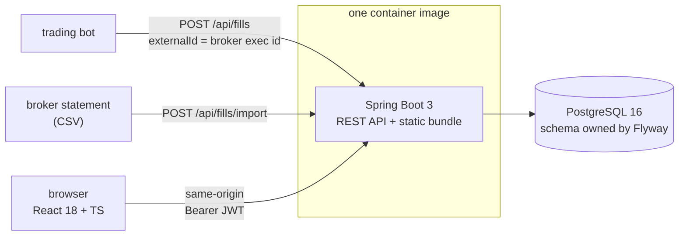
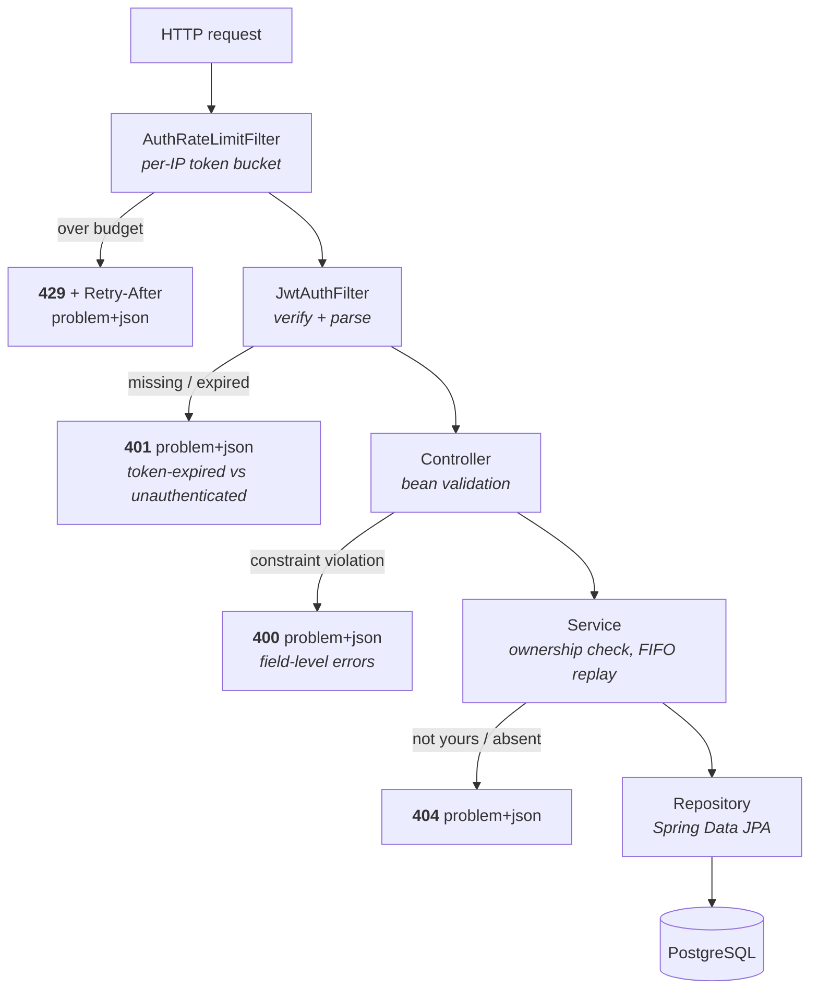
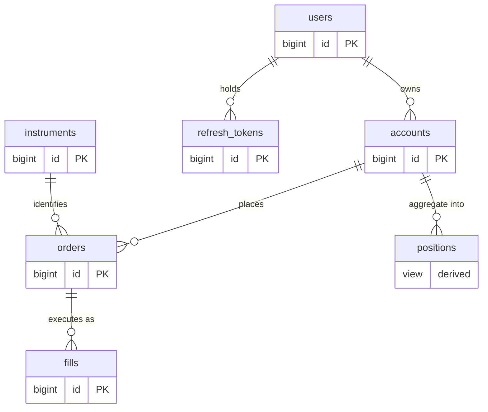
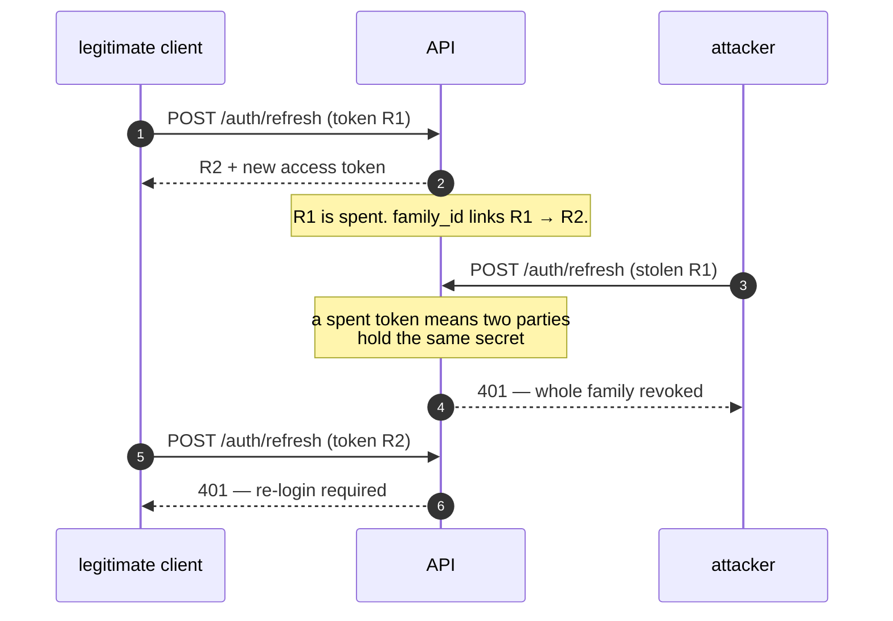

# tradejournal

**A full-stack trade journal: ingests trading-bot fills into PostgreSQL through a Spring Boot REST API, with a normalized schema, versioned migrations, rotating-JWT authentication, and a React dashboard for reviewing positions and performance.**

[](https://github.com/a0merr/tradejournal/actions/workflows/ci.yml)
[](#testing)
[](https://github.com/a0merr/tradejournal/releases)
[](https://openjdk.org/)
[](https://spring.io/projects/spring-boot)
[](https://www.postgresql.org/)
[](https://react.dev/)
[](LICENSE)

**Status — no hosted demo yet.** Rather than link a URL that isn't there, here is what *is* verifiable right now: CI builds the exact production image, boots it against a real PostgreSQL 16, and drives it over HTTP — sign in as the seeded demo user, read back reconstructed positions, confirm an unauthenticated call is refused — on every single commit. That job is [`production image (build + boot + smoke)`](.github/workflows/ci.yml); its result is the badge above. Hosting is one dashboard connect away ([DEPLOY.md](DEPLOY.md)), and [this line becomes the URL](#deploying) when it is.

`docker compose up --build` runs the whole thing locally in one command.

---

## Contents

- [What this is](#what-this-is) · [What works today](#what-works-today) · [Architecture](#architecture) · [Database schema](#database-schema)
- [REST API](#rest-api) · [Design decisions](#design-decisions) · [Failure scenarios tested](#failure-scenarios-tested) · [Testing](#testing)
- [Run it locally](#run-it-locally) · [Operating it](#operating-it) · [Deploying](#deploying) · [Demo video](#demo-video)

---

## What this is

A trading bot generates a stream of fills — individual executions, each with a price, quantity, and fee. `tradejournal` is where those fills go to become reviewable: it ingests them through a REST API, stores them in a normalized PostgreSQL schema, reconstructs positions and realized performance from them, and surfaces it in a React dashboard.

It is a deliberately realistic full-stack application — auth with revocable sessions, versioned migrations, an indexed relational schema, integration tests against a real database, a production image that CI proves will boot — built to look like something a team would run, not a tutorial to-do list.

---

## What works today

Everything in this table is implemented and covered by the test suite or the CI smoke job. Nothing else in this README describes future work without saying so.

| Area | Implemented | Where |
|---|---|---|
| Schema | 6 versioned Flyway migrations, FKs, indexes, `NUMERIC` money, a `positions` view | [`db/migration/`](backend/src/main/resources/db/migration) |
| Auth | Register, login, refresh, logout. 15-minute JWTs; opaque refresh tokens, single-use, SHA-256 at rest, family-chained with reuse detection | [`AuthService`](backend/src/main/java/com/amerritt/tradejournal/service/AuthService.java), [`RefreshTokenService`](backend/src/main/java/com/amerritt/tradejournal/service/RefreshTokenService.java) |
| Ingestion | `POST /api/fills`, idempotent on the broker execution id, safe under concurrent retries | [`FillWriter`](backend/src/main/java/com/amerritt/tradejournal/service/FillWriter.java), [`V4__fill_idempotency.sql`](backend/src/main/resources/db/migration/V4__fill_idempotency.sql) |
| CSV import | Multipart upload, per-row error reporting, re-import skips rows already on file | [`CsvFillImportService`](backend/src/main/java/com/amerritt/tradejournal/service/CsvFillImportService.java) |
| Positions | Reconstructed from fills by a SQL view — never a stored mutable number | [`V6__positions_view_avg_fill_price_scale.sql`](backend/src/main/resources/db/migration/V6__positions_view_avg_fill_price_scale.sql) |
| Performance | Realized PnL, win rate, closed-trade count, open exposure, FIFO cost basis — one streaming lot-matching replay | [`PnlCalculator`](backend/src/main/java/com/amerritt/tradejournal/service/PnlCalculator.java) |
| Errors | RFC 7807 `application/problem+json` on every path, including rejections from the security filter chain | [`GlobalExceptionHandler`](backend/src/main/java/com/amerritt/tradejournal/exception/GlobalExceptionHandler.java) |
| Abuse control | Per-IP token bucket on the unauthenticated auth endpoints, continuous refill, `Retry-After` | [`RateLimiter`](backend/src/main/java/com/amerritt/tradejournal/security/RateLimiter.java) |
| Precision | `BigDecimal` end to end, serialized as JSON strings; a test fails the build if a `float`/`double` reaches an entity or DTO | [`MonetaryPrecisionTest`](backend/src/test/java/com/amerritt/tradejournal/MonetaryPrecisionTest.java) |
| Frontend | Login, positions table, exposure chart, performance cards, CSV upload, transparent token refresh with single-flight de-duplication | [`frontend/src/`](frontend/src) |
| Packaging | One image: the React bundle is built into the Spring Boot jar, so the deployment has a single origin and no CORS wiring | [`Dockerfile`](Dockerfile) |
| CI | Unit + Testcontainers suites, frontend typecheck/build, and a job that boots the production image and smoke-tests it over HTTP | [`ci.yml`](.github/workflows/ci.yml) |

### Not implemented — and what that costs

Listed because a portfolio README that only enumerates strengths is not information.

| Gap | Consequence today |
|---|---|
| **No hosted demo** | You have to run it yourself to see it. Blocked on a hosting account, not on code — see [Deploying](#deploying). |
| **No demo video** | Script and shot list are written ([DEMO.md](DEMO.md)); recording waits on the hosted instance. |
| **No price feed** | Every figure is realized or cost-basis. There is no unrealized PnL, because there is no mark. `openExposure` prices open lots at their FIFO basis, not at market. |
| **No order lifecycle** | `OrderStatus` has `NEW`/`PARTIAL`/`FILLED`/`CANCELLED`, but the ingest path only ever writes `FILLED`. There is no state machine and no order-submission endpoint — this journals executions, it does not route orders. |
| **Single currency per account** | Fills carry no currency. An account mixing USD and EUR instruments would sum them as if they were the same unit. |
| **Rate limiting is per instance** | The token buckets are in process memory. Behind *n* replicas the effective limit is *n* × the configured one; the fix is moving the buckets to Redis. |
| **Refresh token in `localStorage`** | Reachable by any XSS on the origin. The fix is an `httpOnly` cookie, which then needs CSRF protection on `/api/auth/refresh` — a change to both tiers, not a one-line move. |
| **PnL is replayed, not stored** | Every `/api/performance` call re-reads an account's fills. It streams and stays bounded by open lots rather than fill count, but the durable fix is a snapshot advanced at ingest with the replay kept as reconciliation. |
| **No frontend tests** | The dashboard is verified by hand and by the CI smoke job hitting the served bundle; there is no component or E2E suite. |

---

## Architecture

One deployable unit, one origin. The React bundle is compiled and copied onto the Spring Boot classpath at image-build time, so the browser, the bot, and the API all talk to the same host.



Inside, a classic layered backend with the cross-cutting concerns pushed to the edge — everything that can reject a request does so before any business logic runs, and every rejection leaves as a problem document.



Controllers handle HTTP and validation, services hold the business logic (position reconstruction, PnL), repositories talk to Postgres through JPA. The schema is owned by Flyway, so the database is versioned in lockstep with the code.

---

## Database schema

The schema is the heart of this project, so it is normalized with intent. A single order can produce many fills (partial executions), instruments are reference data rather than repeated strings, and positions are *derived* from fills rather than stored as a mutable number that can drift.



| Table | Key columns | Notes |
|---|---|---|
| `users` | `id`, `email` (unique), `password_hash` | Auth principal; BCrypt |
| `refresh_tokens` | `id`, `user_id` → users, `token_hash`, `family_id`, `expires_at`, `revoked_at` | Single-use; only the SHA-256 is stored |
| `accounts` | `id`, `user_id` → users, `broker`, `base_currency` | A user may hold several |
| `instruments` | `id`, `symbol`, `exchange`, `asset_class` | Unique on `(symbol, exchange)` |
| `orders` | `id`, `account_id` → accounts, `instrument_id` → instruments, `side`, `type`, `quantity`, `status`, `external_id` | One per submitted order; `(account_id, external_id)` unique where non-null |
| `fills` | `id`, `order_id` → orders, `quantity`, `price`, `fee`, `filled_at` | Many per order; the raw event |
| `positions` | _view_ | Net quantity, total fees, and average fill price, computed from fills |

**Indexes and constraints** are chosen for the real query patterns: `fills(order_id)` and `fills(filled_at)` for journal queries and time-range scans, `orders(account_id, status)` for the open-orders view, a unique constraint on `instruments(symbol, exchange)` to keep reference data clean, a **partial** unique index on `orders(account_id, external_id)` for idempotency, and foreign keys throughout so the database — not the application — guarantees referential integrity. Money is `NUMERIC`, never floating point.

---

## REST API

| Method | Endpoint | Purpose |
|---|---|---|
| `POST` | `/api/auth/register` | Create an account; returns both tokens |
| `POST` | `/api/auth/login` | Obtain an access token + refresh token |
| `POST` | `/api/auth/refresh` | Rotate a refresh token into a new pair |
| `POST` | `/api/auth/logout` | Revoke the session server-side |
| `POST` | `/api/fills` | **Ingest a fill** (the bot's entry point) — idempotent on `externalId` |
| `POST` | `/api/fills/import` | Bulk-import fills from a CSV ([`sample-fills.csv`](sample-fills.csv)) |
| `GET` | `/api/accounts` | The signed-in user's accounts |
| `GET` | `/api/orders` | List orders, filterable by status, paginated (`page`, `size`) |
| `GET` | `/api/orders/{id}` | One order with its fills |
| `GET` | `/api/positions` | Current positions per account |
| `GET` | `/api/performance` | Realized PnL, win rate, exposure, fees |
| `GET` | `/actuator/health` | Liveness/readiness probe |

Protected endpoints require a `Bearer` token. Full request/response schemas are published via OpenAPI at `/swagger-ui` when the app is running.

---

## Design decisions

### Ingestion is idempotent

A bot that times out and retries would otherwise book the same execution twice, and no later fix recovers the history — realized PnL is quietly wrong from then on. Send the broker's execution id as `externalId` and a repeat returns **200** with the fill already on file instead of **201** with a second copy. The guarantee is a partial unique index on `(account_id, external_id)`, so it holds under concurrent retries rather than only under polite ones; the losing insert is caught and resolved into the same 200.

The same key makes CSV re-imports safe. Uploading an overlapping broker statement reports the overlap as `skipped` rather than double-booking it.

### Two prices, because they answer different questions

- **`avgEntryPrice`** — FIFO cost basis of what is still open. The number to compare a market price against. Null once the position is flat.
- **`avgFillPrice`** — quantity-weighted average across every fill, buys and sells alike. An execution-quality figure.

The view originally exposed only the second one, named `avg_price`. After BUY 2 @ 100 and SELL 1 @ 120 it reported 106.67 for a position whose remaining unit was bought at 100 — a plausible-looking number that was not a basis at all. Cost basis needs lot-matching, which a `GROUP BY` cannot express, so it comes from the same FIFO replay that produces realized PnL. One accounting method, one set of books.

Related: **a closed trade is one closing fill, not one matched lot**. A single SELL that closes three entries is one trade, won or lost on its combined result — otherwise win rate drifts with how fragmented the entries happened to be.

### Auth: short access tokens, rotating refresh tokens

A stateless JWT cannot be revoked before it expires — that is the cost of not checking a database on every request. Rather than pay it back with a blacklist lookup, the access token's lifetime is cut to 15 minutes and session continuity moves to an opaque refresh token that *is* server state.



- **Single use.** Every `/api/auth/refresh` spends the presented token and returns a new one.
- **Theft is detectable.** Presenting an already-spent token revokes the entire family, so the thief is locked out and the legitimate user is told, loudly, that something is wrong.
- **A database leak is not a session leak.** Only the SHA-256 of each token is stored.
- **Logout is real.** `/api/auth/logout` revokes the chain server-side instead of only clearing browser storage.

### Errors: RFC 7807 everywhere

Every failure — validation, domain, and the ones the security filter chain raises before a controller is reached — returns `application/problem+json` with a stable `type` URN, `title`, `status`, `detail`, `instance`, and `timestamp`:

```json
{
  "type": "urn:tradejournal:problem:validation-failed",
  "title": "Validation failed",
  "status": 400,
  "detail": "quantity: must be greater than 0",
  "instance": "/api/fills",
  "timestamp": "2026-06-01T10:00:00Z",
  "errors": [{ "field": "quantity", "message": "must be greater than 0" }]
}
```

An expired access token is tagged `urn:tradejournal:problem:token-expired`, which is how the frontend knows to refresh and retry rather than send the user back to the login screen.

### Rate limiting and bounded responses

The unauthenticated auth endpoints run behind a per-IP token bucket — BCrypt makes each guess expensive but nothing stops an attacker making them in parallel forever. Over-budget requests get a `429` with the same problem-document shape and a `Retry-After`. Continuous refill rather than a fixed window, since a window that resets on the hour lets an attacker spend a full budget on either side of the boundary. (The per-instance limitation is listed under [what is not implemented](#not-implemented--and-what-that-costs).)

`/api/orders` is paginated with a server-side maximum page size, sorted by `(created_at, id)` so rows cannot repeat or vanish between pages on a non-unique timestamp. The PnL replay streams its fills and clears the persistence context as it goes, so an account's history is bounded by open lots rather than by fill count.

### Money on the wire

JSON has no decimal type, so a JSON number is parsed as an IEEE-754 double by every browser. `NUMERIC` in Postgres and `BigDecimal` in Java would be undone at that last hop, so every `BigDecimal` is serialised as a JSON **string** and the exact decimal survives to the client. `MonetaryPrecisionTest` fails the build if a `float` or `double` ever appears on an entity or DTO, and separately if a persisted `BigDecimal` omits an explicit `precision`/`scale` — Hibernate's default `(19,2)` would silently truncate the eighth decimal place crypto quantities need.

---

## Failure scenarios tested

The suite is organised around *what goes wrong*, not around class coverage. Each row is a way this system could quietly produce a wrong number or leak data, and the test that stops it.

| # | Failure it prevents | Test |
|---|---|---|
| 1 | A bot retries after a timeout and books the same execution twice | `FillJourneyIT.reingestingTheSameExecutionIsANoOp` |
| 2 | An operator uploads an overlapping broker statement and double-books the overlap | `FillJourneyIT.csvReimportSkipsRowsAlreadyOnFile` |
| 3 | One malformed CSV row rejects the whole file, or is silently dropped | `FillJourneyIT.csvImportCommitsGoodRowsAndReportsBadOnes` |
| 4 | One user writes fills into another user's account | `FillJourneyIT.cannotIngestIntoAccountYouDoNotOwn` (404, so ownership is not disclosed) |
| 5 | A protected endpoint answers without a token | `FillJourneyIT.protectedEndpointRejectsMissingToken` |
| 6 | Cost basis is polluted by the price of units already sold | `PnlCalculatorTest.openBasis_ignoresThePriceOfWhatWasSold`, and end-to-end in `FillJourneyIT.registerIngestAndReconstructPosition` |
| 7 | Lots are matched newest-first, changing basis and realized PnL | `PnlCalculatorTest.openBasis_dropsTheOldestLotFirst` |
| 8 | Win rate moves with how fragmented the entries were | `PnlCalculatorTest.oneSellClosingThreeLots_isOneTrade`, `.tradeIsWonOrLostOnItsCombinedResult` |
| 9 | Fees are ignored on partial closes, overstating PnL | `PnlCalculatorTest.partialClose_chargesProratedFees` |
| 10 | Shorts are mishandled, or a flipping fill loses the close | `PnlCalculatorTest.shortThenCover_realizesGain`, `.flippingFillCountsTheCloseAndOpensTheRemainder` |
| 11 | An empty or open-only account reports a win rate of 0% instead of "no data" | `PnlCalculatorTest.openPositionOnly_hasNoClosedTrades`, `.emptyStream_isFlat` |
| 12 | A stolen refresh token is replayed and the theft goes unnoticed | `AuthRotationIT.reusingASpentTokenRevokesTheWholeFamily` |
| 13 | A spent refresh token still works after rotation | `AuthRotationIT.refreshRotatesBothTokensAndRetiresTheOldRefreshToken` |
| 14 | Logout clears the browser but leaves the session alive server-side | `AuthRotationIT.logoutRevokesTheSession` |
| 15 | Credential stuffing runs unthrottled against `/api/auth/login` | `AuthRateLimitIT.repeatedLoginAttemptsAreThrottledWithAProblemDetail` |
| 16 | The throttle spills onto unrelated endpoints and locks out real traffic | `AuthRateLimitIT.throttlingDoesNotTouchOtherEndpoints` |
| 17 | A rejection from the filter chain returns an empty body the client cannot interpret | `AuthRotationIT.missingTokenIsRejectedByTheFilterChainAsProblemDetail`, `.unknownRefreshTokenIsRejectedAsProblemDetail` |
| 18 | Validation failures arrive without field-level detail | `AuthRotationIT.validationFailureCarriesFieldLevelErrors` |
| 19 | A `double` price is added to an entity and money starts drifting | `MonetaryPrecisionTest.noEntityOrDtoUsesBinaryFloatingPoint` |
| 20 | A `BigDecimal` column maps at Hibernate's default `(19,2)` and truncates crypto quantities | `MonetaryPrecisionTest.mappedDecimalColumnsDeclarePrecisionAndScale` |
| 21 | The rule-enforcing scanner silently matches nothing and the guards above pass vacuously | `MonetaryPrecisionTest.scannerFindsTheModelAndDtoTypes` |
| 22 | The bucket refills in a burst at a window boundary, doubling the effective budget | `RateLimiterTest.refillsContinuously`, `.doesNotRefillBeyondCapacity` |
| 23 | One noisy client's throttle locks out every other client | `RateLimiterTest.keysAreIndependent` |
| 24 | Idle-bucket eviction hands a throttled client a fresh budget | `RateLimiterTest.evictionDropsRecoveredKeysAndKeepsThrottledOnes` |
| 25 | The published demo credentials do not actually sign in | `DemoSeedTest.seededDemoUserAcceptsTheDocumentedPassword`, `DemoSeedIT.theDocumentedDemoCredentialsSignIn` |
| 26 | The demo account signs in but the dashboard is empty | `DemoSeedIT.theSeededAccountHasPositionsToLookAt` |
| 27 | The production image does not start, or starts without its migrations / static bundle | `image` job in [`ci.yml`](.github/workflows/ci.yml) — boots the image against PostgreSQL, signs in as the demo user, reads positions, and asserts an unauthenticated call still gets a 401 problem document |

Scenarios 25 and 26 exist because the CI image job found the defect on its first run: the seed's
password hash — copied in as "the well-known sample hash for the literal `password`" — matched no
password at all, so the demo login published in `DEPLOY.md` had never worked. The suite could not
have caught it. The seed loads under the `dev` profile, which the integration tests do activate, but
every one of them registered a throwaway user of its own, so the demo account was the single user
path nothing exercised. It is now covered twice: once structurally against the SQL, once over HTTP.

Two things the timing-sensitive tests deliberately avoid: `RateLimiterTest` drives a `Clock` it controls rather than sleeping, and `AuthRateLimitIT` lowers the budget through `@DynamicPropertySource` rather than making hundreds of real requests. Tests that sleep are tests that flake.

---

## Testing

```bash
cd backend && mvn verify    # requires Docker (Testcontainers spins up PostgreSQL 16)
```

**42 tests**, split by what they assert:

| Suite | Tests | Kind |
|---|---:|---|
| `PnlCalculatorTest` | 14 | Pure unit — FIFO lot-matching, no Spring, no database |
| `RateLimiterTest` | 6 | Pure unit — token bucket against a controlled `Clock` |
| `MonetaryPrecisionTest` | 3 | Structural — classpath scan that fails the build on float money |
| `DemoSeedTest` | 1 | Structural — the seeded demo hash matches the published password |
| `AuthRotationIT` | 7 | Integration — Testcontainers, real PostgreSQL 16 |
| `FillJourneyIT` | 6 | Integration — Testcontainers, real PostgreSQL 16 |
| `DemoSeedIT` | 3 | Integration — Testcontainers, real PostgreSQL 16 |
| `AuthRateLimitIT` | 2 | Integration — Testcontainers, real PostgreSQL 16 |
| **Total** | **42** | 24 unit / 18 integration |

Integration tests run against **real PostgreSQL via Testcontainers**, not an in-memory substitute — so migrations, constraints, the partial unique index, and view SQL are exercised exactly as they run in production. Every CI run prints these counts to its job summary, so the number in this README is checkable rather than claimed.

The `Test` / `IT` suffix is load-bearing: Surefire runs `*Test` in the fast phase, Failsafe runs `*IT` in the integration phase, and `mvn verify` runs both. That split only works if `maven-failsafe-plugin` is actually declared — it was not, so for several commits the integration suite compiled on every build and ran on none of them, and `mvn verify` returned green in 23 seconds. The counts above are now the counts CI executes; the job summary is the receipt.

---

## Run it locally

The whole stack comes up with one command via Docker Compose — Postgres, the Spring Boot API, and the React dev server:

```bash
git clone https://github.com/a0merr/tradejournal.git
cd tradejournal
docker compose up --build
```

- Frontend → http://localhost:5173
- API → http://localhost:8080
- Swagger UI → http://localhost:8080/swagger-ui

Flyway applies the migrations on first boot, so the database is ready with no manual setup. The `dev` profile loads a demo account: **`demo@tradejournal.dev` / `password`**.

To build and run the single production image instead — the one CI smoke-tests and the one that gets deployed:

```bash
docker build -t tradejournal .
docker run --rm -p 8080:8080 \
  -e SPRING_PROFILES_ACTIVE=demo \
  -e SPRING_DATASOURCE_URL=jdbc:postgresql://host.docker.internal:5432/tradejournal \
  -e SPRING_DATASOURCE_USERNAME=tradejournal \
  -e SPRING_DATASOURCE_PASSWORD=tradejournal \
  -e TRADEJOURNAL_JWT_SECRET="$(openssl rand -base64 32)" \
  tradejournal
# dashboard and API both on http://localhost:8080
```

To run the pieces separately during development:

```bash
# backend (needs a local Postgres on :5432, or run `docker compose up db` first)
cd backend && mvn spring-boot:run

# frontend
cd frontend && npm install && npm run dev
```

> Prefer `./mvnw`? Generate the Maven wrapper once with `mvn -N wrapper:wrapper`.

---

## Operating it

| Variable | Default | Notes |
|---|---|---|
| `SPRING_PROFILES_ACTIVE` | _(none)_ | `dev` or `demo` also load the seed. Neither should be set for real data. |
| `SPRING_DATASOURCE_URL` / `_USERNAME` / `_PASSWORD` | local Postgres | Or supply the discrete `DB_HOST`/`DB_PORT`/`DB_NAME`/`DB_USER`/`DB_PASSWORD` parts. |
| `TRADEJOURNAL_JWT_SECRET` | dev-only placeholder | **Must** be overridden with a 256-bit value in any deployment. |
| `TRADEJOURNAL_JWT_EXPIRATION_MINUTES` | `15` | Access-token lifetime. |
| `TRADEJOURNAL_REFRESH_EXPIRATION_DAYS` | `30` | Refresh-token lifetime. |
| `TRADEJOURNAL_RATE_LIMIT_ATTEMPTS` | `20` | Auth attempts per window, per IP. |
| `TRADEJOURNAL_RATE_LIMIT_WINDOW_MINUTES` | `5` | Refill window for the above. |
| `TRADEJOURNAL_CORS_ORIGINS` | `http://localhost:5173` | Only needed if the frontend is served from a different origin than the API. The production image serves both, so it can be left alone. |

- **Health:** `GET /actuator/health` returns `{"status":"UP"}` once Flyway has finished; it is the container's health check in both the Fly and Render configs.
- **Migrations** run automatically at boot and are validated against the entity mappings (`ddl-auto: validate`), so a drifted schema fails startup instead of corrupting data.
- **Expired refresh tokens** are swept by [`RefreshTokenCleanupJob`](backend/src/main/java/com/amerritt/tradejournal/service/RefreshTokenCleanupJob.java) rather than accumulating forever.
- **Uploads** are capped at 2 MB (`spring.servlet.multipart`), so a large CSV is refused rather than exhausting heap.

---

## Deploying

Two ready configurations, both building the same single image:

- [`render.yaml`](render.yaml) — Render Blueprint: managed PostgreSQL + one web service, JWT secret generated by the platform.
- [`fly.toml`](fly.toml) — Fly.io: one machine, suspend-on-idle so a cold link wakes in about a second.

[DEPLOY.md](DEPLOY.md) has the step-by-step for both, including what to check when a first deploy fails.

**Why there is no link here yet:** the Fly path is blocked on a payment method (`We need your payment information to continue`), and the Render path needs one Blueprint connect in the dashboard, which cannot be scripted. Both configs are committed, and the CI `image` job proves the artifact they deploy boots and serves traffic. The moment either is connected, this section becomes a URL.

---

## Demo video

Planned. [DEMO.md](DEMO.md) holds the 90-second script, shot list, and recording setup; it walks the ingest → position → PnL path plus the idempotent-retry and stolen-token behaviours, because those are the parts a screenshot cannot show. Recording waits on the hosted instance so the video shows the deployed system rather than a laptop.

---

## Project structure

```
tradejournal/
├── Dockerfile                   # production image: React bundle baked into the Spring Boot jar
├── backend/                     # Spring Boot API
│   ├── Dockerfile               # API-only image, used by docker-compose
│   ├── src/main/java/com/amerritt/tradejournal/
│   │   ├── controller/          # REST endpoints
│   │   ├── service/             # business logic (positions, PnL, CSV import)
│   │   ├── repository/          # Spring Data JPA
│   │   ├── model/               # entities
│   │   ├── dto/                 # request/response records
│   │   ├── exception/           # RFC 7807 handling
│   │   ├── security/            # JWT filter, rate limiter, problem-detail entry points
│   │   └── config/
│   ├── src/main/resources/
│   │   ├── db/migration/        # Flyway: V1__init.sql … V6__…
│   │   ├── db/seed/             # repeatable demo seed (dev + demo profiles)
│   │   └── application.yml
│   └── src/test/                # JUnit 5 + Testcontainers
├── frontend/                    # React + Vite + TypeScript
│   └── src/
├── .github/workflows/ci.yml     # tests, frontend build, production-image smoke test
├── docker-compose.yml
├── render.yaml · fly.toml       # deployment configs
└── DEPLOY.md · DEMO.md
```

---

## Roadmap

Ordered by what would most improve the system, not by what is easiest.

- [ ] Hosted demo on a public URL _(blocked on a hosting account, not on code)_
- [ ] 90-second demo video _(script written; needs the hosted instance)_
- [ ] Refresh token in an `httpOnly` cookie, with CSRF protection on the refresh endpoint
- [ ] Per-`(account, instrument)` PnL snapshots advanced at ingest, replay kept as reconciliation
- [ ] Currency on fills; today an account is implicitly single-currency
- [ ] Redis-backed rate-limit buckets so the limit survives horizontal scaling
- [ ] A price feed, and with it unrealized PnL and mark-to-market exposure
- [ ] Frontend component/E2E tests

---

## License

Released under the MIT License — see [LICENSE](LICENSE).

## Contact

**Andrew Merritt** — [GitHub](https://github.com/a0merr) · [LinkedIn](https://www.linkedin.com/in/andrew-merritt-ab425537a) · a0merr05@louisville.edu
